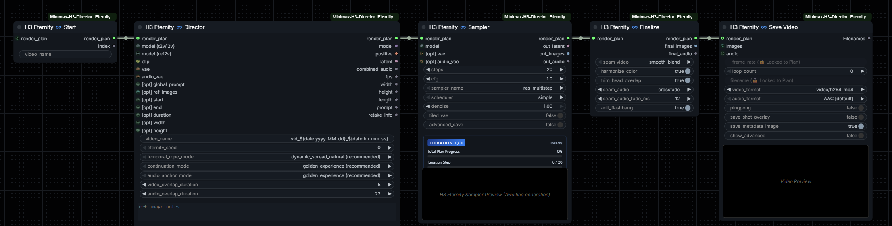
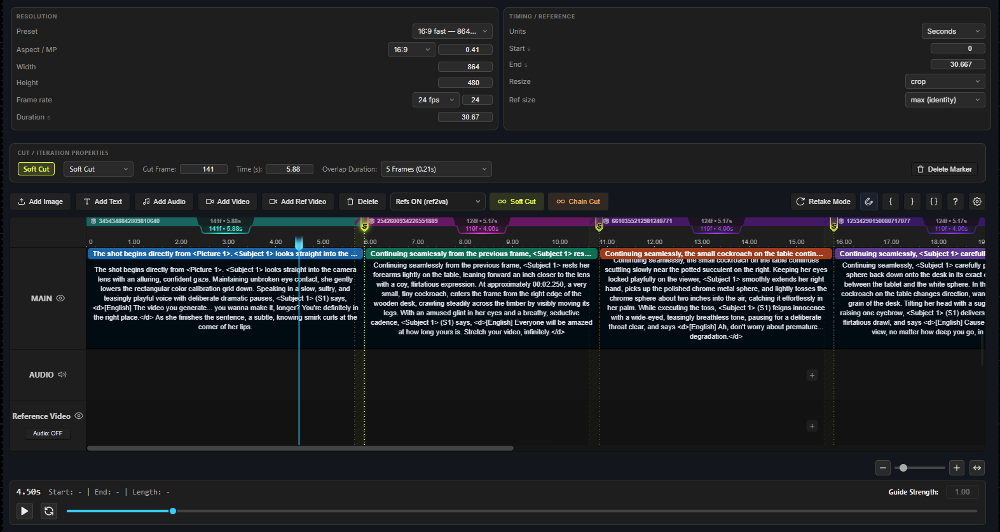
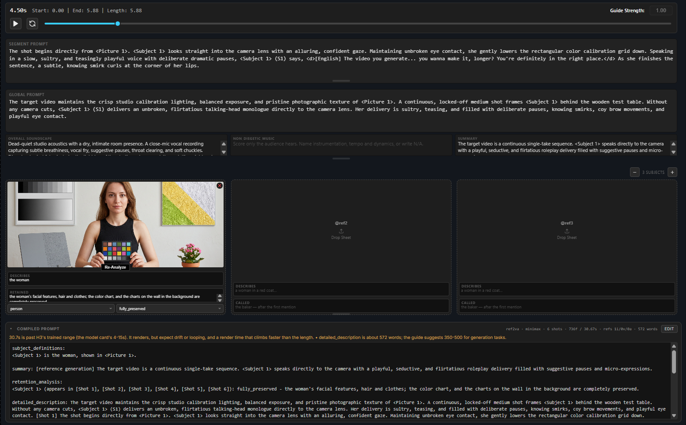

# **Minimax H3 Eternity Director**

> ##### Maintained by [FurkanKarabudak](https://github.com/Furkan-Karabudak)

---

**Minimax H3 Eternity Director** is an advanced ComfyUI extension designed for long-form audiovisual generation with MiniMax H3. It transforms the single-clip generation limit into a seamless, recursive continuation engine with lossless hybrid latent stitching, an interactive visual timeline editor, automatic A/V synchronization, and clean multi-clip finalization.  
> `If you find this project helpful for your workflows, consider supporting its ongoing development!`  

---

## ⚡ Quick Start: Core Architecture & Topology

The core workflow operates as a clean recursive pipeline connected through a central state carrier: the **`render_plan`**. 

To build your workflow, search for nodes with the **`♾️`** symbol. These 5 nodes form the primary Eternity topology:

> [!IMPORTANT]
> - All core nodes must be wired consecutively via their **`render_plan`** pins.
> - **Alternative Samplers**: You can use either **`H3 Eternity ♾️ Sampler`** (standard, easy-to-use) or **`H3 Eternity ♾️ Sampler Advanced`** (provides granular control over steps, sigmas, and preview behavior).
> - All pins prefixed with **`[opt]`** are completely optional. You do not need to connect anything to them unless you are automating specific inputs from external nodes.

---

## 🎬 Essential Rules for Model & Sampling Setup

### 1. Model Wiring (Always Route Through the Director)
Connect your MiniMax H3 model directly into the **`H3 Eternity ♾️ Director`** input. Then, connect the **`model` output of the Director** into your **`H3 Eternity ♾️ Sampler`**. Do not connect the raw models directly into the Sampler nodes.

### 2. Do not use `ModelSamplingMiniMaxH3`
> [!WARNING]
> **Do not connect `ModelSamplingMiniMaxH3`** or apply manual `shift_video` / `shift_audio` before the Director node. The Director node automatically calculates and applies the correct video and audio sigma shifts internally, alongside dynamic 3D-RoPE temporal position offsets.

### 3. Recommended Settings: `golden_experience` ;)
For the smoothest generation, **keep the default node values**. In particular:
- **`continuation_mode`**: `golden_experience (recommended)`
- **`audio_anchor_mode`**: `golden_experience (recommended)`
- **`temporal_rope_mode`**: `dynamic_spread_natural (recommended)`

The `golden_experience` continuation engine decouples video and audio seams, using unanchored acoustic references and hybrid keyframe anchors to eliminate A/V sync drift and prevent chromatic degradation across iterations.

### 4. Video Name Inheritance
You can specify a project name in either the **Start**, **Director**, or **Save Video** node:
- If you set a `video_name` in the **Start** node, downstream nodes (**Director** and **Save Video**) will automatically inherit and lock that exact project name.
- If left blank upstream, you can name it directly in the Director or Save Video node.
- Supports dynamic timestamp tokens such as `vid_${date:yyyy-MM-dd}_${date:hh-mm-ss}`.

---

## ⏱️ Interactive Timeline Editor

The timeline allows you to author audiovisual stories visually, dividing long-form videos into distinct, timed prompt segments and multi-iteration render passes:

### Key Timeline Concepts
- **Segments**: Click anywhere on the timeline to create an audiovisual segment. Each segment defines what happens within that time slice.
- **Iterations & Cut Markers**:
  - MiniMax H3 operates best in segments satisfying the temporal lattice ($17k + 5$ frames, e.g. ~5s to ~10s per generation window).
  - To generate longer videos, split the timeline using **Soft Cut** or **Chain Cut** markers.
  - **Each cut creates a new Iteration**. During execution, the Eternity loop automatically renders Iteration 1, captures the anchor state, feeds it into Iteration 2, and seamlessly stitches the clips together in the Finalize node.
- **Timeline Images vs. Global References**:
  - **Image placed directly on the timeline**: Acts as a strict temporal anchor (e.g., First Frame / Keyframe) defining exactly what is on screen at that timestamp.
  - **Global Subject / Reference (at the bottom panel)**: Serves as an unanchored style or identity reference (e.g., character appearance, general environment) that the model can draw from anywhere in the video.

---

## 📝 Prompting & Reference Management

Below the timeline ruler sits the prompt authoring and reference inspector:

### Prompt Hierarchy
1. **Segment Prompt**: Specific description of visual actions, camera motions, and dialogue occurring within the selected segment.
2. **Global Prompt**: Scene-wide instructions applied across the entire video (visual tone, camera aesthetic, overall art style, lighting).
3. **Overall Soundscape**: Ambient environment sounds, Foley, background noise, and natural acoustic elements.
4. **Non-Diegetic Music**: Background music, soundtrack, and cinematic score heard only by the audience.
5. **Summary**: Brief plot or storyboard summary.
6. **Compiled Prompt (Bottom Panel)**: Real-time preview of the exact MiniMax-compliant prompt compiled from your timeline segments, markers, and references. **Always inspect this panel before queuing!**

### Prompting Tips for Continuity
- When describing a continuation segment (Iteration 2 and beyond), starting the segment prompt with **`Continues seamlessly, ...`** or a similar transitional phrase strongly reinforces visual and motion continuity across the cut boundary.
- For dialogue, wrap speech in language-tagged dialogue brackets: `<d>[English] Hello world! </d>`.

---

## 📚 Detailed Prompt Guides

MiniMax H3 requires strict adherence to its multimodal prompt syntax. Detailed reference documentation is included directly in this repository:

- 📖 **[Base Prompt Writing Guide (T2VA / I2VA / FL2VA / L2VA)](assets/docs/prompt_guide_base.md)**:  
  Covers pure text-to-video, image-to-video, first-and-last frame keyframing, camera direction, and acoustic soundscape formatting.
- 📖 **[Full-Reference Mode Guide (REF2VA)](assets/docs/prompt_guide_ref2va.md)**:  
  Covers multi-subject tracking (`<Subject N>`), image reference anchoring (`<Picture N>`), motion guidance videos (`<Video N>`), and external audio reference matching (`<Audio N>`).

---

## 📦 Example Workflows

Pre-configured workflow files are provided in the **[`example_workflows/`](example_workflows/)** directory to help you get started immediately:

- 🎬 **[H3-Eternity_SingleShot_Ref2VA.json](example_workflows/H3-Eternity_SingleShot_Ref2VA.json)**:  
  A complete, working reference workflow demonstrating a single-shot generation in **REF2VA** mode. Perfect for inspecting proper model wiring, prompt configuration, and reference connections.
- 📄 **[H3-Eternity_empty.json](example_workflows/H3-Eternity_empty.json)**:  
  A clean, blank starter template with the core Eternity topology pre-wired (`Start` ➔ `Director` ➔ `Sampler` ➔ `Finalize` ➔ `Save Video`) and empty prompt fields. Ideal if you want to start building your own custom video generation from scratch.

---

## 🌟 Acknowledgements & Credits

This project builds upon and forks exceptional open-source work in the ComfyUI video generation ecosystem. Please make sure to check out and star these foundational projects:

1. **[ComfyUI-MiniMaxH3-MV-Director](https://github.com/vomitselfie/ComfyUI-MiniMaxH3-MV-Director)** by **[vomitselfie](https://github.com/vomitselfie)**  
   *The direct upstream fork that introduced long-form enhancements.*
2. **[ComfyUI-MiniMaxH3-Director](https://github.com/seesee75-commits/ComfyUI-MiniMaxH3-Director)** by **[seesee75-commits](https://github.com/seesee75-commits)**  
   *The foundational MiniMax H3 timeline director and reference handling architecture.*
3. **[WhatDreamsCost-ComfyUI (LTX Director)](https://github.com/WhatDreamsCost/WhatDreamsCost-ComfyUI)** by **[WhatDreamsCost](https://github.com/WhatDreamsCost)**  
   *The original timeline editor and visual interface concept that started it all.*

---

## 📄 License

This project is distributed under the **GNU General Public License v3.0 (GPL-3.0)**. See the [LICENSE](LICENSE) file for more details.

